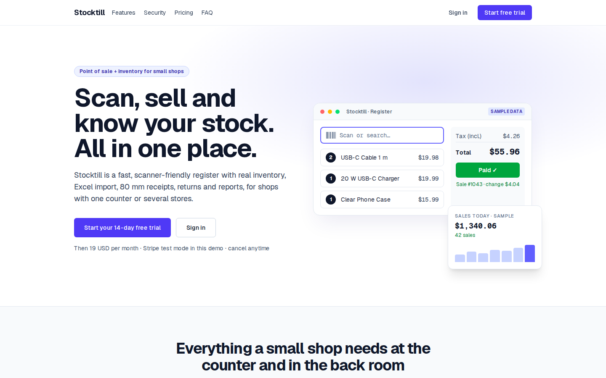
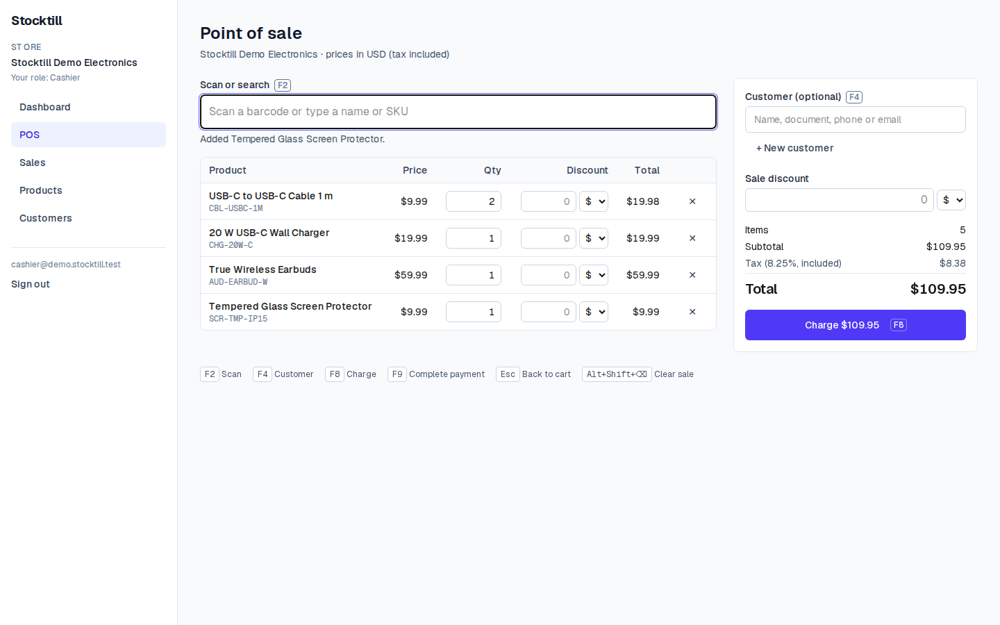
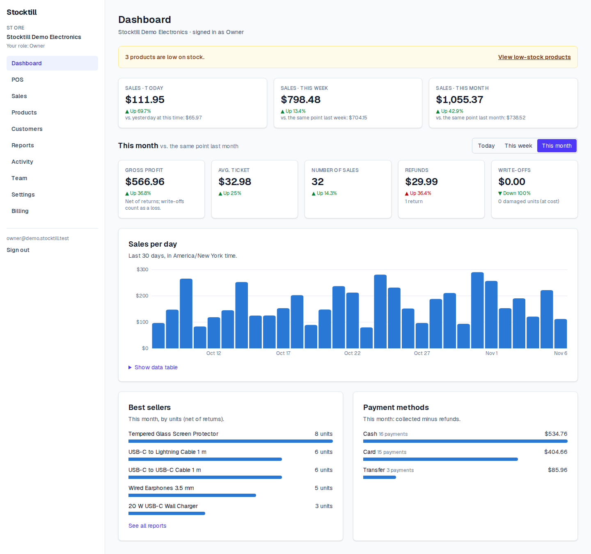
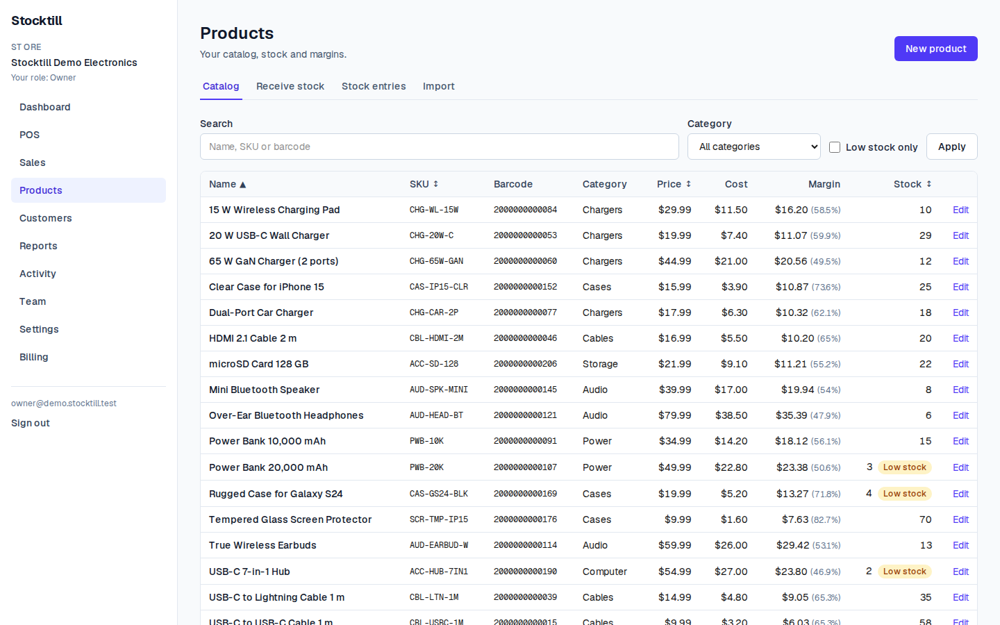
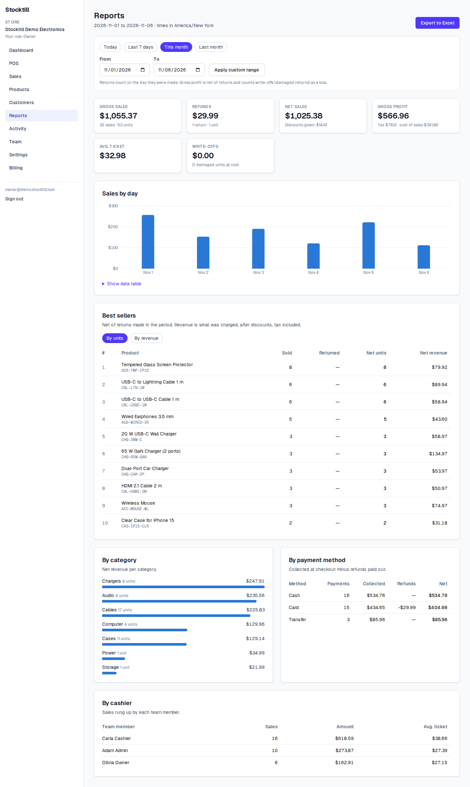
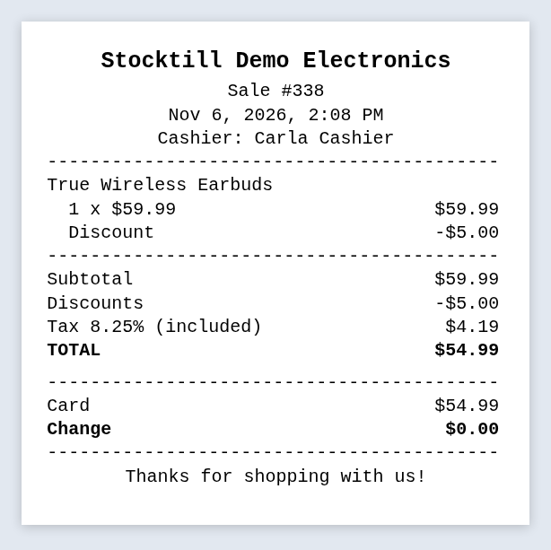
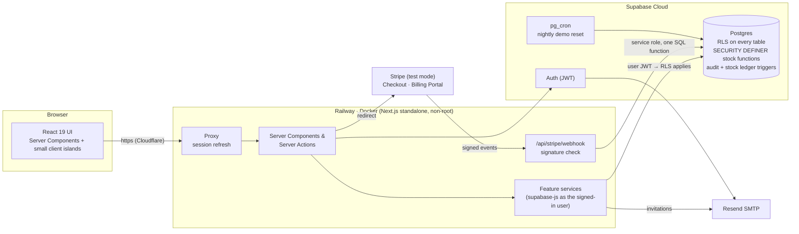

# Stocktill

> **Stocktill is a fictional brand** created for a portfolio project. It is not a commercial product and is
> not affiliated with any real company.

**Multi-tenant point of sale and inventory SaaS for small shops.** Every business signs up, creates its
store and only ever sees its own data, isolated by PostgreSQL Row Level Security. Cashiers ring up sales
with a USB barcode scanner, stock is moved only by database functions with a full ledger, and owners get
dashboards, reports and Excel exports. A Stripe subscription (test mode) is included.

**Live demo: <https://stocktill.renzzogg.com>.** On the sign-in page, click **Try the live demo** and pick
Owner, Admin or Cashier. It's a sample electronics store with 60 days of history and it resets every night.

[](https://github.com/RenzzoGG/retail-pos-saas/actions/workflows/ci.yml)


| Landing (GSAP) | Point of sale |
| --- | --- |
|  |  |
| **Dashboard** | **Inventory** |
|  |  |
| **Reports** | **80 mm ticket (PDF)** |
|  |  |

## Features

- **Multi-tenant with roles**: owner, admin and cashier per store. Invitations by email. A user can
  belong to several stores and switch between them.
- **Fast checkout**: keyboard-first and compatible with USB barcode readers (`F2` scan, `F8` charge, `F9`
  complete). Line and sale discounts with a per-store cashier limit, split payments, change, and
  double-click-safe charging.
- **Inventory**: SKU and EAN barcodes, stock entries with weighted average cost, low-stock alerts, and an
  append-only stock ledger.
- **Excel / CSV import** with a row-by-row preview, an error report and an "update existing" mode.
- **80 mm PDF tickets** for sales and returns, with a reprint from the sale detail.
- **Returns** linked to the sale line (owner/admin only), back to stock or written off, with a pro-rated
  refund.
- **Customers** with their purchase history.
- **Dashboard and reports**: profit net of returns, best sellers, categories, payment methods and
  cashiers, in the store's time zone, with an **Excel export**.
- **Activity log** of every change, written by triggers.
- **Subscription with Stripe** (test mode): 19 USD/month, a 14-day trial, Checkout and the Billing
  Portal. Access depends on the subscription state.
- **Animated landing** with GSAP (ScrollTrigger and SplitText) that respects `prefers-reduced-motion`.

## Architecture



- **All reads and writes go through supabase-js as the signed-in user**, so RLS always applies. The only
  exception is the Stripe webhook: it has no user, so it uses the service role, but it can only call one
  SQL function.
- **Drizzle ORM is used only for the schema and migrations**. Policies, functions and triggers are
  hand-written SQL migrations next to them.
- **Permissions are checked three times**: in the UI (to hide what you can't do), in the server (to give
  a clear error) and in the database (RLS, column grants and functions, which is the part that actually
  enforces them).

## Technical highlights

### Multi-tenant isolation with RLS
Every business table has a `store_id` and RLS policies based on the user's memberships. Column-level
grants limit what a client can write: `stock`, `created_by`, totals and counters are never
client-writable. A pgTAP suite proves that one store can't read or write another's data, through every
table and function.

### Stock only changes through database functions
`create_sale`, `create_return` and `create_stock_entry` are the only way to change stock.
- A trigger refuses any other write to `products.stock`, even from `service_role`.
- Each sale decrements stock with a conditional update (`stock >= qty`), so two cashiers selling the last
  unit are serialized on the row and one gets `insufficient_stock`.
- Products are locked in id order, so concurrent sales can't deadlock.
- Every change is recorded in `stock_movements`, and a test checks that `stock = Σ movements`.
- The server sets the numbers: prices come from the database, tax from the store settings, and the
  payments must add up exactly to the total. Money is `numeric(12,2)`, never `float`.

### Idempotent checkout
Each sale carries an idempotency key generated by the browser. `create_sale` takes a transaction-level
advisory lock on (store, key). If the key already exists, it returns the original sale, so a double
click, a retry or a flaky network never charges twice. The unique constraint
`(store_id, idempotency_key)` is the last safety net.

### RLS that scales: 26× faster reports
Policies that call a `SECURITY DEFINER` membership check run that check **once per row**. Rewriting them
as `store_id in (select app.member_store_ids())` lets Postgres evaluate it once per query. Measured with
50,000 sales and 100,000 lines:

| Query (owner, with RLS) | Before | After |
| --- | --- | --- |
| Summary, 365 days | 13.7 s | 0.52 s |
| Summary, 30 days | 1.08 s | 46 ms |
| Products, 365 days | 1.9 s | 0.25 s |

### Stripe webhooks: verified, idempotent, ordered
The webhook route verifies the signature on the raw body and then calls a single SQL function,
`apply_stripe_event`, which runs in one transaction:
- it records the event id, so redeliveries are no-ops;
- it ignores events older than the last one applied, so out-of-order delivery can't undo a newer state;
- it updates the subscription.

Access by subscription state (setup, full, read-only) is then enforced with database triggers, so it
covers every write path.

### Landing with GSAP, Lighthouse 96 / 100
The landing is a static Server Component (prerendered with Partial Prerendering) with a few client islands:
- a **live POS in the hero**, driven by a GSAP timeline over the same tested cart reducer;
- `ScrollTrigger` sections, built lazily as they near the viewport;
- `SplitText` headings and a pinned security section.

The plugins are loaded with dynamic `import()` and not downloaded at all with reduced motion. Lighthouse
performance went from 74 to a **median of 96 on mobile (100 on desktop)**.

### Production hardening
- **Docker image**: multi-stage, standalone output, **94 MB compressed**, runs as the unprivileged `node`
  user, with a healthcheck on `/api/health`. CI builds it, starts it and requires it to be healthy.
- **Security headers**: a static CSP (`script-src 'self'`, `connect-src` limited to Supabase,
  `frame-ancestors 'none'`, `form-action` limited to Stripe's hosted pages), HSTS, `X-Frame-Options`,
  `Referrer-Policy`, `nosniff` and `Permissions-Policy`. The CSP is static rather than nonce-based, so the
  landing stays prerendered. The trade-off is explained in [`docs/DESIGN.md`](docs/DESIGN.md) §7.
- **Public demo that can't be ruined**: a SQL function rebuilds the demo store every night with pg_cron,
  and database triggers lock what could break it for the next visitor (team, invitations, store settings,
  new stores).

## Stack

| Layer | Technology |
| --- | --- |
| App | Next.js 16 (App Router, Server Actions, Cache Components), React 19, TypeScript, Tailwind CSS 4 |
| Data | Supabase (PostgreSQL, Auth, RLS), supabase-js, Drizzle ORM (schema and migrations) |
| Payments | Stripe Checkout, Billing Portal and webhooks (test mode) |
| Files | PDFKit (80 mm tickets), SheetJS (Excel import and export) |
| Animation | GSAP 3 (ScrollTrigger, SplitText, `@gsap/react`) |
| Tests | Vitest (unit and integration), pgTAP (database), Playwright (E2E and production smoke) |
| Delivery | Docker (multi-stage), GitHub Actions, Railway, Cloudflare, Supabase Cloud, Resend |

## Run locally

Requirements: **Node.js 24** with npm, and **Docker** (the Supabase CLI runs its services in containers).

```bash
npm ci                       # install dependencies (includes the Supabase CLI)
npm run supabase:start       # start local Supabase (first run downloads images)
cp .env.example .env.local   # fill in the URL and publishable key from `npm run supabase:status`
npm run dev                  # http://localhost:3000
```

Other ways to start the app:
- `npm run dev:local` runs without a `.env.local`: it reads the local URL and key from `supabase status`
  at runtime, without printing them.
- `npm run docker:dev` runs the app in Docker Compose with hot reload.
- `npm run docker:prod` builds and runs the **production image** against local Supabase, on
  <http://localhost:8080>.

Health check: `curl http://localhost:3000/api/health` → `{"status":"ok"}`.

Other local tools:
- **Mailpit** catches every email (confirmations, password resets, invitations): <http://localhost:54324>.
- **Supabase Studio**: <http://localhost:54323>.

### Demo data (local only)

`supabase/seed.sql` runs on `npm run db:reset`. **The password is for local development only.**

| Email | Role | Store |
| --- | --- | --- |
| `owner@demo.stocktill.test` | owner | Stocktill Demo Electronics (USD, prices include 8.25 % tax) |
| `admin@demo.stocktill.test` | admin | Stocktill Demo Electronics |
| `cashier@demo.stocktill.test` | cashier | Stocktill Demo Electronics |
| `owner@other.stocktill.test` | owner | Other Shop (EUR, 21 % tax added), for isolation checks |

The password for all of them is `stocktill-demo`. The demo store has 20 electronics accessories, 3
customers and 60 days of sales and returns. It is built by `reset_demo_store()`, the same function that
rebuilds the public demo every night. Try the barcodes `2000000000015` (USB-C cable) or `2000000000053`
(20 W charger) in the POS. Import samples are in `docs/samples/`.

## Tests and CI

| Command | What it covers |
| --- | --- |
| `npm test` | Unit tests: money and tax math, discounts, import parser, report periods, CSP, demo config… |
| `npm run test:db` | **pgTAP**: RLS on every table, tenant isolation, role permissions, stock integrity and ledger, audit log, billing access, demo reset and locks |
| `npm run test:integration` | Server services against local Supabase, signed in as real users: roles, invitations (email in Mailpit), POS, concurrency, returns, import, reports, Stripe webhook |
| `npm run test:e2e` | **Playwright** on the production build: sign-up → onboarding → invitation, scanner checkout, receipts, returns, import, reports, billing, landing, security headers (no CSP violations), demo |
| `npm run test:smoke` | Read-only smoke test against a deployed URL (`SMOKE_BASE_URL=https://… npm run test:smoke`) |
| `npm run lint` / `npm run typecheck` / `npm run db:lint` | ESLint, TypeScript and SQL function linting |

On every push, **GitHub Actions** runs three jobs. With branch protection on `main`, a pull request can't be
merged unless all of them pass:
1. lint, typecheck, unit tests and build;
2. the database job: Supabase starts in the runner, then the migration checks, pgTAP, SQL lint,
   integration and E2E tests run;
3. the production Docker image is built and started, and must report healthy.

First time with Playwright: `npx playwright install chromium`. On Linux or WSL, also run
`sudo npx playwright install-deps chromium`.

## Deployment

The production setup is Supabase Cloud (free plan) for the database, Railway for the Docker container,
Cloudflare for DNS and TLS, Resend for email and Stripe in test mode.
[`docs/DEPLOY.md`](docs/DEPLOY.md) covers it step by step, with every environment variable explained.

> **Heads-up: free Supabase projects pause after a week without activity.** If the demo stops responding,
> the project needs to be restored from the Supabase dashboard (**Restore project**, a few minutes). The
> nightly demo reset keeps the database active, which usually prevents the pause.

## Documentation

- [`docs/DESIGN.md`](docs/DESIGN.md): architecture, data model, RLS, stock functions, reports,
  billing, landing, deployment and risks (in Spanish).
- [`docs/PHASES.md`](docs/PHASES.md): the 12 phases of the project and their definition of done.
- [`docs/DEPLOY.md`](docs/DEPLOY.md): production deployment guide.
- [`docs/STRIPE.md`](docs/STRIPE.md): Stripe test-mode setup.
- [`docs/reports/`](docs/reports/): a report for each phase.

## License

[MIT](LICENSE). Stocktill is a fictional brand. All stores, people, products and barcodes in the demo are
made up.
