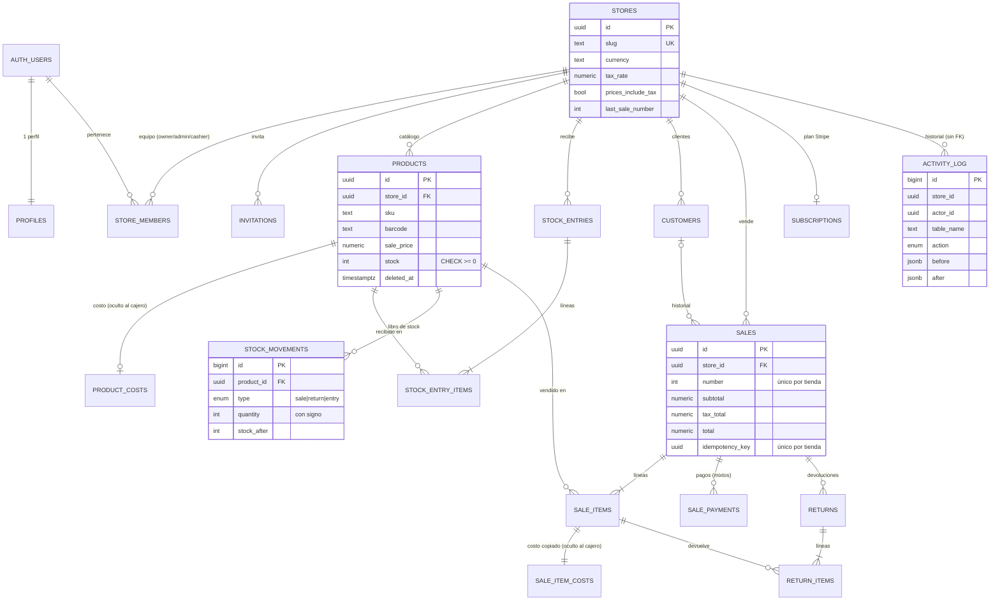

# Diseño técnico — Stocktill (POS SaaS multitienda)

> **Stocktill es una marca ficticia** creada para un proyecto de portafolio; no es un producto comercial.
>
> Estado: diseño aprobado al cierre de la Fase 0 (decisiones confirmadas por el usuario).
> Interfaz de usuario en inglés; documentación en español.

## 1. Arquitectura general

```
                         ┌──────────────────────────────────────────────┐
  Navegador              │  Contenedor Docker (Railway en producción)   │
  (POS, dashboard,       │                                              │
   landing GSAP)  ─────► │  Next.js (App Router)                        │
                  HTTPS  │   • Server Components  → lecturas            │
                         │   • Server Actions     → mutaciones          │
                         │   • Route Handlers     → /api/stripe/webhook │
                         │                          /api/tickets/[id]   │
                         │                          /api/exports/...    │
                         └───────┬───────────────────────┬──────────────┘
                                 │ JWT del usuario       │ firma del webhook
                                 ▼                       ▲
              ┌──────────────────────────────┐   ┌───────┴────────┐
              │ Supabase                     │   │ Stripe (test)  │
              │  • Auth (sesión por cookies) │   │  • Checkout    │
              │  • PostgreSQL + RLS          │   │  • Billing     │
              │  • Funciones SQL (RPC)       │   │    Portal      │
              │  • Storage (imágenes, Excel) │   │  • Webhooks    │
              └──────────────────────────────┘   └────────────────┘
```

**Flujo típico:** el navegador llama a una Server Action → la acción lee la sesión de Supabase desde
las cookies (`@supabase/ssr`), valida el rol y los datos (Zod) → llama a la BD **con el JWT del usuario**,
de modo que RLS se aplica siempre → para operaciones críticas (venta, devolución, entrada) llama a una
función SQL que hace todo en una sola transacción.

**Stripe:** la app crea una sesión de Checkout; Stripe cobra y envía eventos al webhook
`/api/stripe/webhook`. El webhook verifica la firma, registra el evento (idempotencia) y actualiza la tabla
`subscriptions`. Las páginas de la app consultan esa tabla para permitir o bloquear el acceso.

**Entornos:**

| | Local (WSL) | Producción |
|---|---|---|
| App | Docker Compose (`next dev`) o `npm run dev` | Contenedor en Railway (Dockerfile multi-stage) |
| Supabase | Supabase CLI (`supabase start`, levanta sus propios contenedores) | Supabase Cloud, plan gratuito (los proyectos inactivos se pausan) |
| Stripe | Modo prueba + `stripe listen` para reenviar webhooks | Modo prueba, webhook al dominio de Railway |

*Por qué Supabase CLI y no meter Supabase en nuestro Compose:* el CLI ya orquesta ~10 servicios
(Postgres, GoTrue, PostgREST, Storage, Studio...) con versiones probadas entre sí; replicarlo a mano en
Compose es frágil. **Decidido:** Compose se usa solo para la app.

**Cómo habla el contenedor de la app con Supabase local (Fase 1):** el CLI publica los puertos de
Supabase en el host (API `54321`, Postgres `54322`). Dentro del contenedor, `127.0.0.1` es el propio
contenedor, así que `compose.yaml` añade `extra_hosts: host.docker.internal:host-gateway` y define
`SUPABASE_INTERNAL_URL=http://host.docker.internal:54321` para el **servidor** de Next.js. El
**navegador** sigue usando `NEXT_PUBLIC_SUPABASE_URL=http://127.0.0.1:54321`. Como `@supabase/ssr`
nombra la cookie de sesión según el hostname de la URL, ambos clientes usan un nombre fijo
(`sb-stocktill-auth-token`) para que la sesión coincida. Se descartó unir el contenedor a la red
interna del CLI (`supabase_network_<project_id>`, depende de nombres internos y solo existe tras
`supabase start`) y `network_mode: host` (menos portable y anula el mapeo de puertos).

### Acceso a datos — decidido
- **Drizzle** define el esquema en TypeScript y genera las migraciones SQL. RLS, funciones y triggers
  se escriben como SQL en migraciones personalizadas (Drizzle permite migraciones "custom").
- **En runtime** la app consulta con `supabase-js` usando el JWT del usuario: PostgREST ejecuta cada
  consulta con el rol `authenticated` y los claims del usuario, y RLS se aplica automáticamente.
- Los tipos de Drizzle (`InferSelectModel`) se reutilizan en la app.
- *Por qué no Drizzle directo en runtime:* una conexión directa a Postgres entra como un rol con
  privilegios y **se salta RLS**, salvo que en cada transacción hagamos `set local role authenticated` y
  `set local request.jwt.claims`. Es posible, pero un olvido = fuga de datos entre tiendas.
- La clave **service role** (salta RLS) solo se usa en: webhook de Stripe y scripts de seed. Nunca en
  código que atienda peticiones de usuarios.

## 2. Modelo de datos (implementado en la Fase 2)

Fuente de verdad: `db/schema/*.ts` (Drizzle) → `supabase/migrations/*_schema.sql`. RLS, privilegios,
triggers y funciones están en `*_security.sql` y `*_functions.sql` (migraciones SQL personalizadas,
registradas en el journal de Drizzle). `supabase db reset` aplica todo en orden y luego `supabase/seed.sql`.

**Convenciones**
- PK `uuid default gen_random_uuid()` (excepto `activity_log` y `stock_movements`: `bigint identity`,
  porque son registros de solo-añadir y ordenarlos por id es útil).
- `created_at`/`updated_at timestamptz` (`updated_at` lo mantiene el trigger `app.set_updated_at`).
- Dinero `numeric(12,2)`; tasas `numeric(5,4)`; cantidades `integer` (solo unidades enteras).
- Todas las tablas de negocio llevan `store_id` (la clave del aislamiento).
- **Claves foráneas compuestas** `(x_id, store_id) → padre(id, store_id)` en todas las tablas hijas.
  *Por qué:* RLS solo valida el `store_id` de la fila que escribes. Sin la FK compuesta, el usuario de
  la tienda A podría insertar en su tienda una fila que apunte a un producto o cliente de B si adivinara
  su UUID. Con la FK compuesta, la BD exige que el padre pertenezca a la **misma** tienda.
- `CHECK`: stock ≥ 0, cantidades > 0, montos ≥ 0, pagos > 0, descuento ≤ subtotal, moneda ISO
  (`^[A-Z]{3}$`), `tax_rate` entre 0 y 1, signo del movimiento acorde a su tipo, efectivo entregado ≥ monto.
- Índices en `store_id`, `(store_id, created_at)` para ventas/movimientos/log, y únicos parciales
  `(store_id, sku)` y `(store_id, barcode)` solo para productos no borrados (soft delete).

**Impuestos y moneda por tienda:** `stores.currency`, `stores.tax_rate`, `stores.prices_include_tax`.
- Impuesto incluido: `total = subtotal − descuento`, `tax = round(total · r / (1 + r), 2)`.
- Impuesto añadido: `tax = round((subtotal − descuento) · r, 2)`, `total = base + tax`.
- Cada venta copia `tax_rate` y `prices_include_tax`, así cambiar la configuración no altera el pasado.

**Costo promedio ponderado** (decidido en la Fase 2): cada entrada recalcula
`costo = (stock · costo_actual + cant · costo_entrada) / (stock + cant)`; si el stock era 0, el costo pasa a
ser el de la entrada. Cada venta copia el costo vigente en `sale_item_costs` para calcular la utilidad.

### Diagrama entidad-relación



### Tablas (19)
| Grupo | Tabla | Para qué |
|---|---|---|
| Identidad | `stores` | Negocio: nombre, slug, moneda, impuestos, pie de ticket, contador de ventas |
| | `profiles` | Nombre del usuario (1-1 con `auth.users`, creado por trigger) |
| | `store_members` | Usuario ↔ tienda con rol `owner`/`admin`/`cashier` |
| | `invitations` | Invitaciones por email con rol (nunca `owner`), token guardado como hash |
| Inventario | `products` | SKU, código de barras, precio de venta, stock, umbral de stock bajo, soft delete |
| | `product_costs` | Costo promedio ponderado (tabla aparte: el cajero no la ve) |
| | `stock_entries` / `stock_entry_items` | Entradas de mercancía con costo unitario |
| | `stock_movements` | Libro mayor de stock: `stock = Σ quantity` por producto |
| Ventas | `customers` | Clientes; su historial son sus `sales` |
| | `sales` | Cabecera: número por tienda, totales, impuesto copiado, estado, clave de idempotencia |
| | `sale_items` | Líneas con copia de nombre/SKU/precio |
| | `sale_item_costs` | Costo copiado por línea (utilidad; oculto al cajero) |
| | `sale_payments` | Pagos `cash`/`card`/`transfer`, mixtos, con efectivo entregado |
| | `returns` / `return_items` | Devoluciones ligadas a la venta y a cada línea |
| Auditoría | `activity_log` | Quién creó/editó/borró qué (antes/después), inmutable |
| Stripe | `subscriptions` | Estado del plan por tienda (lo escribe el webhook) |
| | `stripe_events` | Eventos procesados (idempotencia del webhook) |

`import_batches` (importación de Excel) se crea en la Fase 5.

## 3. Seguridad: RLS, privilegios y roles (implementado en la Fase 2)

### Cómo funciona RLS (resumen para aprender)
- PostgREST (la API de Supabase) verifica el JWT del usuario y ejecuta cada consulta como el rol
  `authenticated` con los *claims* del token en `request.jwt.claims`; `auth.uid()` lee de ahí el `sub`.
  Sin sesión, la consulta corre como `anon`.
- Con RLS activado, Postgres añade a cada consulta la condición de la política:
  - **`USING`** filtra qué filas existentes ves, actualizas o borras. Una fila que no pasa es invisible:
    un `UPDATE`/`DELETE` sobre otra tienda afecta **0 filas** sin dar error.
  - **`WITH CHECK`** valida la fila nueva en `INSERT`/`UPDATE`. Si no pasa → error `42501`.
  - Sin ninguna política para una operación → denegada (**negar por defecto**).
- RLS decide **filas**; los **privilegios (`GRANT`)** deciden operaciones y **columnas**. Usamos ambos.
- El dueño de las tablas (`postgres`) y `service_role` saltan RLS. Por eso la clave `service_role` solo
  existe en el servidor (webhook de Stripe, seeds) y las funciones `SECURITY DEFINER` revalidan todo.

### Capas de defensa (todas deben permitir la acción)
1. **Privilegios mínimos:** `anon` no tiene ningún privilegio en `public`. `authenticated` solo lo
   necesario, con **privilegios por columna**: nunca puede escribir `products.stock`,
   `stores.last_sale_number`, `id`, `store_id` (al actualizar) ni `created_by`/`invited_by` (los llena un
   trigger con `auth.uid()`, así nadie se hace pasar por otro). Las tablas de ventas, devoluciones, libro
   de stock, historial y suscripción no tienen INSERT/UPDATE/DELETE para `authenticated`.
   `alter default privileges` evita que futuras tablas se concedan a `anon` automáticamente.
2. **RLS en las 19 tablas** con las políticas de abajo.
3. **Funciones `SECURITY DEFINER`** como única vía para escribir ventas, devoluciones, entradas y stock.
4. **Triggers de integridad:** `app.guard_stock` (el stock no cambia fuera de las funciones, ni siquiera
   con `service_role`), `app.ensure_store_has_owner` (una tienda nunca se queda sin owner),
   `app.block_activity_log_changes` (historial inmutable para todos).
5. **Constraints:** FKs compuestas y `CHECK`.

### Funciones auxiliares (schema `app`)
`app.is_store_member(store_id)`, `app.has_store_role(store_id, roles[])`, `app.is_store_manager(store_id)`
(= owner o admin) y `app.shares_store_with(user_id)`.
- **Por qué `SECURITY DEFINER`:** la política de `store_members` necesita consultar `store_members`; si la
  consulta pasara por RLS habría recursión infinita. Como *definer*, la función lee la tabla con los
  privilegios de su dueño y devuelve solo un booleano.
- **Por qué es seguro:** (1) responden solo sobre el usuario actual (`auth.uid()` del JWT), nunca sobre un
  usuario pasado por parámetro, así no sirven para espiar membresías ajenas; (2) `set search_path = ''`
  y nombres totalmente calificados (`public.store_members`, `auth.uid()`) impiden el secuestro por
  `search_path` (crear un objeto con el mismo nombre en otro schema para que la función lo use);
  (3) el schema `app` no está expuesto por PostgREST, así que no se pueden llamar como `/rpc`;
  (4) `EXECUTE` revocado a `PUBLIC`/`anon`. Una prueba pgTAP falla si alguna función definer no fija
  `search_path`.

### Políticas por tabla (todas `to authenticated`)
"miembro" = `app.is_store_member(store_id)`; "manager" = owner o admin.

| Tabla | SELECT | INSERT | UPDATE | DELETE | Por qué |
|---|---|---|---|---|---|
| `stores` | miembro | — | manager (solo columnas de config) | — | La creación llega en la Fase 3 con una función que crea tienda + owner en una transacción |
| `profiles` | uno mismo o compañeros de tienda | — (trigger) | uno mismo (`full_name`) | — | Ver nombres del equipo sin exponer a usuarios ajenos |
| `store_members` | miembro | `app.can_manage_role`: owner cualquier rol; admin solo `cashier` | ídem (USING = fila actual, WITH CHECK = fila nueva) | ídem | Desde la Fase 3 **solo el owner gestiona admins**: el admin no puede invitar, ascender, degradar ni quitar admins ni owners |
| `invitations` | manager | `app.can_manage_role` (owner: admin/cashier; admin: cashier) | — | ídem | Aceptar = `accept_invitation()`; el CHECK impide invitar owners; un solo pendiente por email y tienda |
| `products` | miembro | manager (sin `stock`) | manager (sin `stock`) | — | El POS necesita nombre/precio/stock; borrar = `deleted_at` (las ventas siguen apuntando al producto) |
| `product_costs` | manager | manager | manager (`cost_price`) | — | Costos fuera del alcance del cajero |
| `stock_entries`, `stock_entry_items`, `stock_movements` | manager | — | — | — | Incluyen costos; se escriben solo con funciones |
| `customers` | miembro | miembro | miembro | manager | El cajero registra clientes en caja |
| `sales`, `sale_items`, `sale_payments`, `returns`, `return_items` | miembro | — | — | — | El cajero ve todas las ventas de su tienda (reimprimir ticket, decidido en Fase 2); escribir solo con funciones |
| `sale_item_costs` | manager | — | — | — | Es la utilidad |
| `activity_log` | manager | — | — | — | Lo escribe un trigger `SECURITY DEFINER`; inmutable |
| `subscriptions` | miembro | — | — | — | Todos necesitan saber si la tienda está activa; solo el webhook escribe |
| `stripe_events` | — | — | — | — | Sin políticas ni privilegios: solo `service_role` |

### Matriz de permisos por rol
| Recurso | owner | admin | cashier |
|---|---|---|---|
| Productos (ver nombre, precio de venta, stock) | ✅ | ✅ | ✅ |
| Crear/editar productos, cambiar precios | ✅ | ✅ | ❌ |
| Costos y utilidades | ✅ | ✅ | ❌ |
| Registrar ventas | ✅ | ✅ | ✅ |
| Ver ventas de la tienda | ✅ | ✅ | ✅ |
| Devoluciones | ✅ | ✅ | ❌ |
| Configurar tienda (moneda, impuestos, ticket) | ✅ | ✅ | ❌ |
| Entradas de mercancía / importar Excel | ✅ | ✅ | ❌ |
| Clientes (ver, crear, editar) | ✅ | ✅ | ✅ |
| Borrar clientes | ✅ | ✅ | ❌ |
| Historial de actividad | ✅ | ✅ | ❌ |
| Invitar / cambiar rol / quitar cajeros | ✅ | ✅ | ❌ |
| Invitar / cambiar rol / quitar admins | ✅ | ❌ | ❌ |
| Asignar el rol owner | ✅ | ❌ | ❌ |
| Suscripción y facturación | ✅ | ❌ | ❌ (Fase 9) |

**Tienda activa:** ver §3b.

## 3b. Autenticación, sesión y protección de rutas (implementado en la Fase 3)

### Cómo funciona la sesión con cookies
1. **Login** (`signInWithPassword` en una Server Action): Supabase Auth devuelve un *access token*
   (JWT firmado, vive ~1 h) y un *refresh token*. `@supabase/ssr` los guarda en cookies del dominio de la
   app (`sb-stocktill-auth-token`, troceada si es grande) mediante `cookies().set()`.
2. **En cada petición**, el navegador envía esas cookies. El servidor crea un cliente de Supabase con
   ellas, así cada consulta a la API viaja con el JWT del usuario y **RLS** sabe quién es.
3. **Refresco:** `src/proxy.ts` (el antiguo *middleware*; en Next 16 se llama **Proxy**) corre antes de
   cada ruta y llama `supabase.auth.getClaims()`. Si el access token caducó, usa el refresh token y
   escribe las cookies nuevas en la petición (para que las vea el render actual) y en la respuesta (para
   que el navegador las guarde). Los Server Components no pueden escribir cookies; por eso se hace ahí.
4. **Verificación:** `getClaims()` valida la firma y caducidad del JWT (con las claves públicas JWKS
   del proyecto; si no hay claves asimétricas, pregunta al servidor de Auth). Nunca usamos
   `getSession()` para autorizar: solo decodifica la cookie sin verificarla.
5. **Logout:** `signOut()` invalida la sesión en Auth y borra las cookies.

### Protección de rutas (dos capas)
- **Proxy (optimista):** sin sesión en `/app`, `/onboarding` o `/invite` → `/login?next=…`; con sesión
  en `/login`/`/signup` → `/app`. Es rápido pero **no es la barrera de seguridad** (la doc de Next lo
  advierte: solo lee la cookie).
- **Data Access Layer** (`src/lib/auth/dal.ts`, `server-only`, memoizada con `cache()` de React):
  `requireUser()`, `getMemberships()`, `requireStoreContext()` y `requireRole(roles)`. Cada página
  privada y cada Server Action la llama; las páginas de managers responden **404** a otros roles (no
  revelan que existen). Debajo, RLS sigue siendo la garantía final.
- Con `cacheComponents`, leer cookies fuera de `<Suspense>` es error de build: el layout privado
  envuelve el contenido dependiente de la sesión en `<Suspense>` (estructura estática + streaming), y
  cada sección de `/app` tiene un `loading.tsx` (su propio límite de Suspense) para que las navegaciones
  muestren "Loading…" al instante.
- `getSessionUser()` llama `await connection()` antes de verificar el JWT: supabase-js compara la
  caducidad del token con la hora actual (`Date.now()`), y Next exige marcar ese trabajo como "solo en
  tiempo de petición" para no intentar prerenderizarlo.
- **Estado HTTP de las páginas prohibidas:** como el área privada se transmite por streaming, la
  respuesta ya empezó con `200` cuando la DAL comprueba el rol dentro de `<Suspense>`; `notFound()`
  muestra la pantalla 404 (con `noindex`) pero el código queda en 200 ("soft 404", comportamiento
  documentado de Next 16). No se filtra contenido. Un 404 real exigiría consultar el rol en el Proxy
  (una consulta a la BD en cada petición), que Next desaconseja.

### Tienda activa
Cookie `stocktill_active_store` (`httpOnly`, `SameSite=Lax`, `Secure` en producción, 1 año). Solo
**recuerda** la elección: en cada petición la DAL comprueba que el usuario sea miembro de esa tienda;
si no (cookie manipulada o membresía quitada) usa su primera tienda. Sin membresías → `/onboarding`.
Cambiar de tienda = Server Action `switchStore`, que también valida la membresía.

### Correos (local: Mailpit)
- Confirmación y recuperación los envía **Supabase Auth** con plantillas propias
  (`supabase/templates/*.html`) cuyo enlace va a `/auth/confirm?token_hash=…&type=…`. Esa ruta llama
  `verifyOtp` y crea la sesión. Funciona aunque el correo se abra en otro navegador (el flujo PKCE con
  `code` exige el mismo navegador).
- Invitaciones: las envía **la app** por SMTP con `nodemailer` (`src/lib/email`). En local,
  Mailpit expone SMTP en `54325` (`[local_smtp] smtp_port`). En producción, cualquier proveedor SMTP vía
  `SMTP_*`.
- Redirecciones post-login/confirmación pasan por `safeNextPath` (solo rutas relativas del propio
  sitio: evita *open redirects*).

### Invitaciones
1. Owner/admin envía email + rol. El servidor valida el rol con `invitableRoles` (owner: admin o
   cajero; admin: solo cajero) y la BD lo repite con RLS (`app.can_manage_role`).
2. Se generan **32 bytes aleatorios** (`base64url`); el enlace del correo lleva el token y la BD guarda
   solo su **SHA-256** (`token_hash`). Expira en **7 días**; reenviar reemplaza el pendiente.
3. El invitado abre `/invite/<token>`: si no tiene sesión inicia sesión o se registra (el `next` lo trae
   de vuelta); `invitation_preview` muestra tienda y rol.
4. `accept_invitation(token)` (definer) bloquea la invitación (`for update`) y valida que exista, no esté
   usada ni vencida, y que **el email del usuario sea el invitado**; crea la membresía y marca
   `accepted_at`/`accepted_by`. Estado mostrado: `pending`, `expired` o `accepted` (calculado).

### Funciones SQL de la Fase 3
| Función | Quién | Qué hace |
|---|---|---|
| `create_store(name, currency, tax_rate, prices_include_tax)` | cualquier usuario autenticado | Tienda + configuración + membresía owner en una transacción; slug con sufijo aleatorio |
| `invitation_preview(token)` | autenticado con el token | Tienda, rol, email y estado de la invitación |
| `accept_invitation(token)` | el usuario invitado | Valida y crea la membresía |
| `app.can_manage_role(store, role)` | (políticas) | owner → cualquier rol; admin → solo `cashier` |
| `app.hash_token(token)` | (interno) | SHA-256 hex; nadie la puede llamar desde la API |

`profiles.email` se copia de `auth.users` por trigger para que la página del equipo muestre correos.

## 4. Consistencia del stock (implementado en la Fase 2)

Funciones en `public` (expuestas como `/rpc/...` solo para `authenticated`), todas `SECURITY DEFINER`,
`search_path = ''`, y cada una corre en **una transacción**: si algo falla no queda nada a medias.

| Función | Quién | Qué hace |
|---|---|---|
| `create_stock_entry(store_id, items, supplier?, note?)` | owner/admin | Suma stock, recalcula costo promedio ponderado, registra movimiento `entry` |
| `create_sale(store_id, items, payments, idempotency_key, customer_id?, discount?, note?)` | cualquier miembro | Descuenta stock, toma precios de la BD, calcula impuestos, valida pagos = total, numera, copia costos, registra movimientos `sale` |
| `create_return(sale_id, items, reason?, refund_method?)` | owner/admin | Valida cantidad ≤ vendida − devuelta, reembolso proporcional, repone stock, movimiento `return`, estado de la venta |

Garantías:
1. **Nadie escribe `products.stock` directamente**: sin privilegio de columna para `authenticated`, y
   `app.guard_stock` lo rechaza incluso a `service_role`/`postgres` salvo que la transacción venga de una
   de las tres funciones (bandera local `app.stock_write`, que la API no permite fijar).
2. **Descuento atómico con bloqueo de fila:**
   `update products set stock = stock - q where id = … and stock >= q returning …`. Si no devuelve fila
   → `insufficient_stock`. Dos ventas simultáneas del último artículo se serializan en la fila.
   Los productos se procesan **ordenados por id** en todas las funciones para evitar interbloqueos.
3. **`CHECK (stock >= 0)`** como última red. Cantidades enteras > 0 validadas (rechaza `1.5`, `0`, `-2`).
4. **Libro de movimientos:** cada cambio inserta en `stock_movements` (con `stock_after`); una prueba
   verifica `stock = Σ movimientos` y el saldo acumulado de cada movimiento.
5. **Idempotencia:** `pg_advisory_xact_lock` por (tienda, clave) y, si la clave ya existe, se devuelve la
   venta original sin cobrar dos veces. Restricción única `(store_id, idempotency_key)`.
6. **El servidor manda en los números:** precio desde `products`, impuestos desde `stores`, y la suma de
   pagos debe ser exactamente el total.
7. **Devoluciones:** bloquean la venta (`for update`); reembolso = parte proporcional del total (prorratea
   descuentos e impuestos); la devolución que completa la venta reembolsa exactamente el resto, así la suma
   nunca supera el total por redondeo. Si la venta es de otra tienda responde `sale_not_found` (no revela
   que existe).
8. **Número de venta consecutivo por tienda** con `update stores set last_sale_number = last_sale_number + 1`
   (bloquea la fila de la tienda durante la venta; aceptable para tiendas pequeñas).

Errores de las funciones (el `message` es un código estable para mostrar mensajes en la UI):
`not_authenticated`, `forbidden` (42501); `invalid_items`, `invalid_quantity`, `invalid_amount`,
`invalid_discount`, `invalid_payments`, `payments_mismatch`, `duplicate_product`,
`missing_idempotency_key` (22023); `product_not_found`, `customer_not_found`, `sale_not_found`,
`sale_item_not_found` (P0002); `insufficient_stock`, `return_exceeds_sold`, `store_needs_owner` (23514);
`stock_is_read_only`, `activity_log_is_append_only` (42501).

**Pendiente (Fase 6):** prueba de concurrencia real con dos conexiones simultáneas (Vitest + `postgres`);
pgTAP corre en una sola sesión.

### Historial de actividad
`app.log_activity` (trigger `AFTER INSERT/UPDATE/DELETE`) en `stores`, `store_members`, `invitations`,
`products`, `product_costs`, `customers`, `stock_entries`, `sales` y `returns`: guarda tienda, actor
(`auth.uid()`, nulo si fue el servidor), tabla, id, acción y el registro antes/después en JSON (sin
`token_hash`). Ignora los cambios que solo tocan `updated_at`, `stock` o `last_sale_number` (la historia del
stock está en `stock_movements`). `store_id`/`actor_id` no tienen FK a propósito: el historial es
inmutable y debe sobrevivir aunque se borre la tienda o el usuario.

## 4b. Inventario e historial (implementado en la Fase 4)

### Rutas
| Ruta | Quién | Qué |
|---|---|---|
| `/app/products` | todos | Catálogo: búsqueda (nombre, SKU o código), categoría, "Low stock only", orden por columnas, paginación en el servidor. Costo y margen solo para owner/admin |
| `/app/products/new`, `/app/products/[id]` | owner/admin | Crear/editar/borrar (lógico) y libro de movimientos del producto |
| `/app/products/receive` | owner/admin | Entrada de mercancía con escaneo de código de barras |
| `/app/products/entries(/[id])` | owner/admin | Historial y detalle de entradas |
| `/app/activity` | owner/admin | Historial de actividad con filtros (usuario, acción, fechas) y paginación |
| `/app` | todos | Aviso de stock bajo con enlace a la lista filtrada |

### Decisiones
- **Costo solo por entradas:** el costo es el promedio ponderado que calcula `create_stock_entry`; el
  formulario de producto lo muestra pero no lo edita. Sin entradas, el costo es "—".
- **Margen sobre el precio neto:** si los precios incluyen impuesto, el impuesto no es ingreso:
  `margen = precio / (1 + tasa) − costo` (`src/lib/money.ts#marginInfo`, aritmética en centavos).
- **`products.is_low_stock`** es una columna **generada** (`stock <= low_stock_threshold`): PostgREST
  no puede comparar dos columnas en un filtro, así que la condición se materializa para filtrar y contar.
  Stock 0 cuenta como bajo. `app.log_activity` la ignora (como `stock`) para que una venta no aparezca
  como edición del producto.
- **Zona horaria por tienda** (`stores.timezone`, IANA, validada por trigger contra
  `pg_timezone_names`): fechas mostradas y filtros "desde/hasta" se calculan en la hora de la tienda
  (`src/lib/timezone.ts`, solo `Intl`). La Fase 8 la reutiliza para ventas diarias.
- **Costos y RLS:** la lista pide `product_costs(cost_price)` solo para managers; aunque un cajero lo
  pidiera, RLS devuelve `[]` (probado).
- **Búsqueda segura:** el texto del usuario se limpia (`escapeSearchTerm`) y va entre comillas en el
  filtro `or(...)` de PostgREST, así no puede alterar la consulta (probado con un intento de inyección).
- **Escaneo:** un lector USB teclea el código y pulsa Enter. En "Scan or search", Enter busca el código o
  SKU **exacto**; si el producto ya está en la lista suma 1. El campo se vacía en el mismo momento del
  Enter (escaneos seguidos no se pisan) y está fuera del `<form>` (un Enter nunca envía la entrada).
- **Historial legible:** `src/features/activity/describe.ts` convierte el JSON antes/después en frases
  ("Product “X” updated: sale price 9.99 → 12.50"), ocultando campos internos. Actor desconocido =
  "Former member"; sin actor = "System".

## 4c. Importación de productos desde Excel/CSV (implementado en la Fase 5)

**Ruta:** `/app/products/import` (owner/admin; pestaña "Import"). Plantillas en
`/app/products/import/template?format=xlsx|csv`. Ejemplos en `docs/samples/` (se regeneran con
`node scripts/generate-import-samples.mjs`).

### Librería: SheetJS CE 0.20.3, vendorizada
- El paquete `xlsx` del registro de npm quedó en 0.18.5 (vulnerabilidades conocidas: prototype pollution y
  ReDoS, corregidas en 0.19.3 y 0.20.2). SheetJS publica las versiones actuales solo en su CDN.
- npm 12 rechaza por defecto dependencias de URLs remotas (`allow-remote`), así que el tarball oficial se
  guardó en `vendor/xlsx-0.20.3.tgz` (verificado: Apache-2.0, sin dependencias, sin scripts de instalación) y
  se instala como `file:`. `package-lock.json` fija su `sha512`; CI y Docker no dependen del CDN.
- Una sola librería lee `.xlsx`/`.csv` y escribe la plantilla.

### El archivo es dato no confiable
| Defensa | Detalle |
|---|---|
| Tamaño | Máx. **1 MB** (`bodySizeLimit` de Server Actions subido a 2 MB para el envío) |
| Filas | Máx. **2.000** productos (también lo exige `import_products`) |
| Tipo | Extensión + firma (`.xlsx` debe ser ZIP; `.csv` texto sin bytes NUL) |
| Zip bomb | Antes de parsear un `.xlsx` se lee el directorio central del ZIP: tamaño descomprimido declarado ≤ 20 MB, ≤ 200 entradas, sin ZIP64 |
| Parser | Solo la primera hoja, `sheetRows` acotado, sin fórmulas/estilos/HTML/VBA; CSV con `raw` (no convierte "0012" en 12) |
| Persistencia | El archivo se procesa en memoria y no se guarda |
| SKU | Debe empezar con letra o dígito, sin espacios (`CHECK products_sku_format`): nunca parece una fórmula |
| Reporte CSV | Celdas que empiezan con `= + - @` se prefijan con `'` (inyección de fórmulas) |

### Flujo
1. **Vista previa** (`previewImportAction`): parsea, mapea encabezados (cualquier orden, sin importar
   mayúsculas, con alias), interpreta números "raros" (`$1,234.50`, `1.234,50`, `12,5`) y valida cada fila
   y columna: obligatorios, precio ≥ 0 con 2 decimales, enteros ≥ 0, costo obligatorio con stock (y no
   permitido sin stock: el costo solo viene de entradas), duplicados de SKU/código dentro del archivo y
   contra la tienda. Carga solo los productos existentes con esos SKU/códigos (en lotes). No guarda nada.
2. **Existentes:** casilla "Update existing products" por importación (decisión del usuario). Apagada → un
   SKU existente es error. Encendida → actualiza nombre, código, categoría, precio y umbral; **una celda
   opcional vacía conserva el valor actual** (un archivo corto no borra datos) y el stock se **suma**.
3. **Confirmación** (`confirmImportAction`): el navegador reenvía el mismo `File`; el servidor comprueba
   su SHA-256 contra el de la vista previa, **revalida contra la BD actual** y llama
   `public.import_products` con las filas válidas.
4. **`import_products`** (definer, una transacción): owner/admin, ≤ 2.000 filas, revalida cada fila, crea
   o actualiza por SKU, junta el stock inicial en **una entrada de mercancía** `source = 'import'` vía
   `app.receive_stock` (la misma lógica de `create_stock_entry`: promedio ponderado y libro de
   movimientos) e inserta `import_batches` (archivo, quién, creadas/actualizadas/omitidas). Si algo falla,
   no se guarda nada.
5. **Reporte de errores:** CSV generado en el navegador con las filas rechazadas, sus valores y motivos.

`import_batches`: lectura solo owner/admin; sin escritura desde la API; su trigger escribe en el historial
("Product import “archivo” created — created: N, updated: N, skipped: N").

## 4d. Punto de venta e historial de ventas (implementado en la Fase 6)

**Rutas:** `/app/pos` (todos los miembros) y `/app/sales`, `/app/sales/[id]` (todos; utilidad solo
owner/admin). En la navegación, "POS" y "Sales".

### Flujo de venta
1. **Escaneo:** el campo "Scan or search" está enfocado al cargar. Enter busca el código o SKU **exacto**
   (`lookupForSale`, solo productos activos y sin costo); el campo se vacía en el mismo Enter (escaneos
   seguidos no se pisan). Protecciones: si nada editable tiene el foco, lo que se teclea va al campo de
   escaneo; Enter en cantidad/descuento devuelve el foco al escaneo; si un lector escribe un código en un
   campo de cantidad (6+ dígitos + Enter) se trata como escaneo y la cantidad no cambia.
2. **Carrito** (`src/features/pos/calc.ts`, centavos, mismas fórmulas que `create_sale`): cantidades,
   descuento por renglón y de venta en **% o monto** (el % se convierte a monto en el navegador; la BD
   recibe montos y valida que no superen lo que descuentan), impuesto incluido o añadido, aviso si la
   cantidad supera el stock conocido. Es solo una vista previa: la BD recalcula con sus precios.
3. **Límite de descuento del cajero:** `stores.max_cashier_discount_pct` (10 % por defecto, editable por
   owner/admin en Settings). `create_sale` rechaza (`discount_limit_exceeded`) si un **cajero** descuenta
   en total (renglones + venta) más de ese % del importe bruto. Owner/admin sin límite. La UI lo anticipa
   y deshabilita "Charge".
4. **Cobro:** `<dialog>` nativo (atrapa el foco, Esc cierra). Varias líneas de pago (efectivo, tarjeta,
   transferencia); "Cash received" calcula el cambio. "Complete sale" solo se habilita si los pagos suman
   **exactamente** el total y el efectivo entregado alcanza.
5. **Idempotencia en el cliente:** la clave se genera al abrir el cobro y se guarda con el carrito en
   `sessionStorage`; cambiar el carrito la descarta. Doble clic (además, un `ref` bloquea el segundo envío),
   reintentos tras un error de red o una recarga durante el cobro reutilizan la clave, y `create_sale`
   devuelve la venta existente. El carrito vive en `sessionStorage`, así que la terminal se monta solo en
   el navegador (`useSyncExternalStore`) para evitar errores de hidratación.
6. **Errores** con el carrito intacto: `insufficient_stock` nombra el producto y lo resalta,
   `discount_limit_exceeded`, `payments_mismatch` (los precios cambiaron), producto inactivo.
7. **Venta completada:** número, total, pagos, efectivo recibido y cambio; "New sale" con Enter.

### Atajos de teclado
`F2` escanear · `F4` cliente · `F8` cobrar · `F9` completar el pago · `Esc` volver al carrito ·
`Alt+Shift+Backspace` vaciar la venta · `Enter` nueva venta (tras completar). Se evitan F1, F5, F11 y F12
porque los usa el navegador.

### Historial y utilidad
- Lista con búsqueda por número, desde/hasta (zona de la tienda), método de pago (embed
  `sale_payments!inner` filtrado) y cajero; paginación.
- **Utilidad = (total − impuesto) − Σ(cantidad × costo copiado en `sale_item_costs`)**. Solo se pide a la
  BD para owner/admin; para un cajero, RLS devolvería vacío igualmente (probado). Las devoluciones (Fase 7)
  la ajustarán.

### Concurrencia (probada)
Dos sesiones distintas (owner y cajero) venden a la vez el último artículo de 10 productos (20 peticiones
simultáneas, cada una en su propia conexión de PostgREST): siempre gana exactamente una por producto, la
otra recibe `insufficient_stock`, el stock queda en 0 y `stock = Σ movimientos`. 5 envíos paralelos con la
misma clave registran una sola venta.

## 5. Estructura de carpetas (propuesta)

```
.
├── CLAUDE.md
├── docs/                      # DESIGN.md, PHASES.md
├── src/
│   ├── app/
│   │   ├── (marketing)/       # landing GSAP, precios
│   │   ├── (auth)/            # login, registro, aceptar invitación
│   │   ├── (app)/             # área privada: pos, inventory, sales, customers, reports, settings
│   │   └── api/               # stripe/webhook, tickets/[id], exports/...
│   ├── features/              # lógica por dominio (inventory, pos, sales, customers, reports, import, billing)
│   │   └── <feature>/         # actions.ts, queries.ts, schemas.ts, components/
│   ├── components/ui/         # componentes reutilizables
│   └── lib/
│       ├── supabase/          # clientes server/browser/middleware
│       ├── auth/              # sesión, tienda activa, guards de rol
│       ├── stripe/
│       ├── money.ts           # aritmética de dinero sin floats
│       └── validation/
├── db/
│   └── schema/                # esquema Drizzle (TS)
├── supabase/
│   ├── config.toml
│   ├── migrations/            # SQL generado por Drizzle + SQL de RLS/funciones
│   └── seed.sql
├── tests/
│   ├── unit/                  # Vitest
│   ├── db/                    # Vitest contra Supabase local (RLS, funciones)
│   └── e2e/                   # Playwright
├── docker/                    # archivos auxiliares
├── Dockerfile
├── compose.yaml
├── .env.example
└── .github/workflows/ci.yml
```

*Por qué `features/`:* agrupar por dominio (no por tipo de archivo) mantiene juntas las acciones,
consultas y validaciones de cada módulo, y escala mejor que carpetas gigantes de `components/`.

## 6. Plan de pruebas

| Nivel | Herramienta | Qué cubre |
|---|---|---|
| Unitarias | Vitest | Cálculo de totales/descuentos/impuestos (precios con impuesto incluido y sin incluir, redondeo), utilidades de dinero, esquemas Zod, parser y validador del Excel, buffer del lector de código de barras |
| Base de datos | **pgTAP** (`npm run test:db` = `supabase test db`), en `supabase/tests/database/` | Estructura (RLS en todas las tablas, privilegios, `search_path` de funciones definer), **aislamiento** A/B en lectura/escritura/RPC, **roles**, **stock** (sin escritura directa, sin negativos, sin sobreventa, `stock = Σ movimientos`), funciones (impuestos, idempotencia, promedio ponderado, devoluciones), historial inmutable y tablas de Stripe |
| Integración | Vitest (`npm run test:integration`) contra Supabase local | Inician sesión como los usuarios demo con la publishable key (leída en tiempo de ejecución de `supabase status`, nunca impresa) y llaman a las mismas *services* que las Server Actions: permisos por rol, invitación de ida y vuelta, entrega del correo en Mailpit |
| E2E | **Playwright** (adelantado de la Fase 11, `npm run test:e2e`) | Chromium real contra el **build de producción standalone** (`npm run build && npm start`, igual que la imagen Docker): registro → confirmación leyendo Mailpit → crear tienda → invitar → aceptar con otro usuario → cambiar rol; comprueba la navegación por rol, la pantalla 404 de páginas de managers y el login con contraseña |
| Concurrencia | Vitest + `postgres` contra Supabase local (Fase 6) | Dos ventas simultáneas del último artículo; reintentos con la misma clave de idempotencia |
| Integración | Vitest | Server Actions con usuarios de prueba; webhook de Stripe con payloads firmados de prueba (`stripe.webhooks.generateTestHeaderString`) |
| Navegador | Playwright | Registro + crear tienda, invitar cajero, venta con "lector" simulado (tecleo rápido + Enter), devolución, importación Excel, restricción de páginas por rol |

- Los usuarios y datos de prueba los crean los propios tests/seeds (registro vía Auth local). No se
  usan tokens fabricados con secretos.
- **Por qué pgTAP:** las pruebas corren dentro de Postgres, cada archivo en una transacción que se
  revierte (no ensucian la BD), y pueden actuar como un usuario igual que PostgREST
  (`set role authenticated` + `request.jwt.claims`) sin claves ni tokens. Los usuarios y tiendas los crea
  cada prueba (`supabase/tests/database/_helpers.psql`).
- **CI (GitHub Actions):** job `checks` (`lint` → `typecheck` → `test` → `build`) y job `database`
  (`supabase start` solo con Postgres → `db:check` → sin deriva esquema/migraciones → `test:db` →
  `db:lint`); `test:e2e` se añade en la Fase 11. Con protección de rama en `main` (configurada por el usuario en
  GitHub) para que no se pueda fusionar si falla.

## 7. Despliegue con Docker en Railway

1. **Dockerfile multi-stage** (npm):
   - `deps`: `node:24-slim`, `npm ci`.
   - `build`: copia código, `next build` con `output: 'standalone'`.
   - `runner`: `node:24-slim`, solo `.next/standalone`, `.next/static` y `public`; usuario no root;
     `HEALTHCHECK`; `CMD ["node", "server.js"]`.

   *Por qué multi-stage + standalone:* la imagen final no lleva herramientas de build ni
   `node_modules` completos → más pequeña (~150–250 MB), arranca más rápido y tiene menos superficie
   de ataque.
2. **Variables públicas en build:** `NEXT_PUBLIC_*` se incrustan al construir, así que Railway debe
   pasarlas como build args.
3. **Railway:** servicio conectado al repo de GitHub, construye con el Dockerfile, variables de entorno
   configuradas en el panel (el usuario las introduce), dominio `*.up.railway.app`, healthcheck en
   `/api/health`.
4. **Base de datos:** Supabase Cloud, **plan gratuito**. Migraciones con `supabase db push` (paso manual
   o job de CI con aprobación). El README advertirá que los proyectos gratuitos inactivos se pausan y
   cómo reactivarlos desde el panel de Supabase.
5. **Stripe:** endpoint de webhook apuntando a `https://<dominio>/api/stripe/webhook` en modo prueba.

## 8. Suscripción (Stripe, modo prueba)

- **Un solo plan:** *Stocktill Monthly*, **19 USD/mes**, con **14 días de prueba gratis**
  (`subscription_data.trial_period_days = 14` en Checkout).
- El owner inicia Checkout desde *Billing*; gestiona tarjeta y cancelación en el **Billing Portal**.
- Eventos procesados: `checkout.session.completed`, `customer.subscription.created|updated|deleted`,
  `customer.subscription.trial_will_end`, `invoice.payment_failed`.
- **Acceso según estado:** `trialing` y `active` → acceso completo; `past_due` → acceso con aviso;
  `canceled`/`unpaid` → solo lectura y página de facturación.
- El ID del precio llega por variable de entorno (`STRIPE_PRICE_ID`), nunca escrito en el código.

## 9. Riesgos y mitigaciones

| Riesgo | Mitigación |
|---|---|
| Fuga entre tiendas por una política RLS olvidada | Prueba automática que lista todas las tablas de `public` y falla si alguna no tiene RLS; pruebas de aislamiento por tabla |
| Uso indebido de la service role | Cliente admin en un módulo `server-only`, usado solo en webhook/seeds; revisión en cada fase |
| Cajero ve costos | Tablas separadas para costos + pruebas de rol |
| Ventas concurrentes / doble clic | Funciones transaccionales, bloqueo de fila, `CHECK`, idempotencia |
| Webhooks duplicados o desordenados | Tabla `stripe_events`; al procesar, releer la suscripción desde la API de Stripe |
| Drizzle y RLS/funciones (Drizzle no modela todo) | SQL manual en migraciones personalizadas; pruebas de BD en CI |
| Precisión del dinero | `numeric` en BD y enteros (centavos) o librería decimal en TS |
| Impresión térmica 80 mm (márgenes, fuentes) | PDF de ancho fijo 80 mm (~72 mm útiles), prueba en impresora real o emulador; opción de imprimir HTML |
| Lectores de código de barras (tecleo rápido + Enter, foco) | Captura global con buffer y umbral de tiempo entre teclas; pruebas unitarias |
| Excel grande o malformado | Límite de tamaño/filas, validación por fila, vista previa antes de confirmar, inserción en una transacción |
| Supabase Cloud gratuito pausa proyectos inactivos (la demo deja de responder) | Aviso en el README con pasos para reactivarlo; seed de demo reproducible |
| Créditos limitados de Railway | Documentarlo en el README; imagen pequeña y una sola instancia |
| Redondeo de impuestos incluidos | Funciones de dinero con pruebas unitarias; redondeo a 2 decimales en un solo lugar |
| WSL + Docker: memoria y rendimiento | Ajustar `.wslconfig`; código dentro del filesystem de Linux (ya está en `~/proyectos`) |
| Variables `NEXT_PUBLIC_*` fijadas en build | Build args en Railway; documentarlo |
